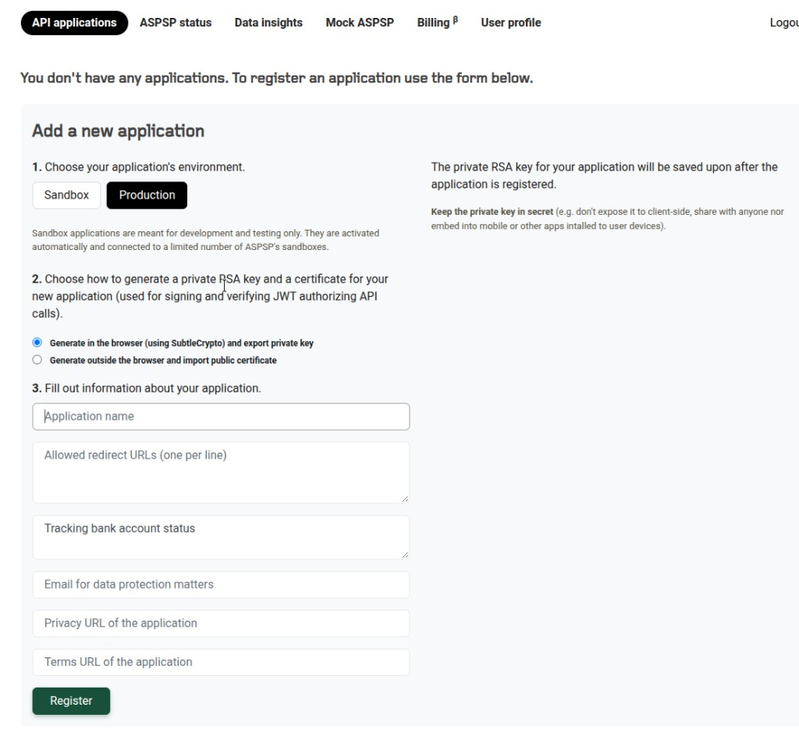
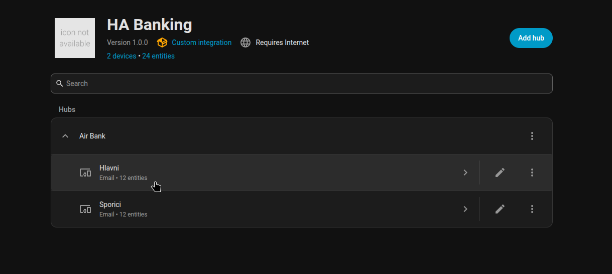
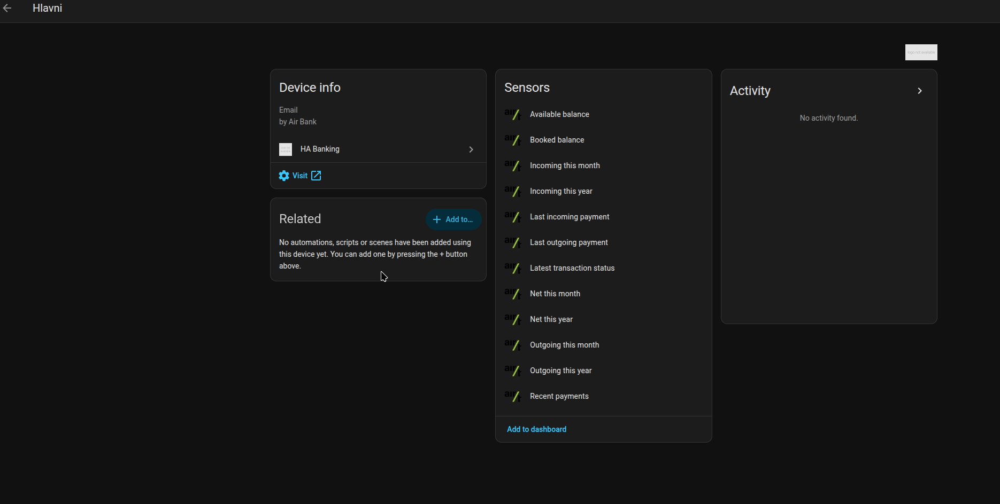
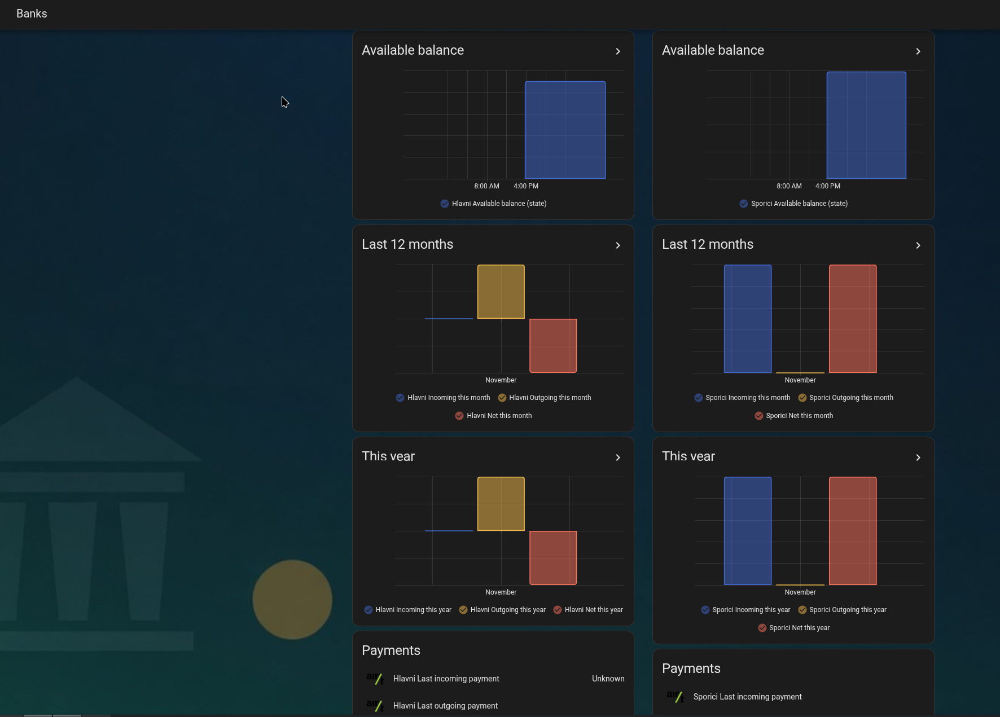
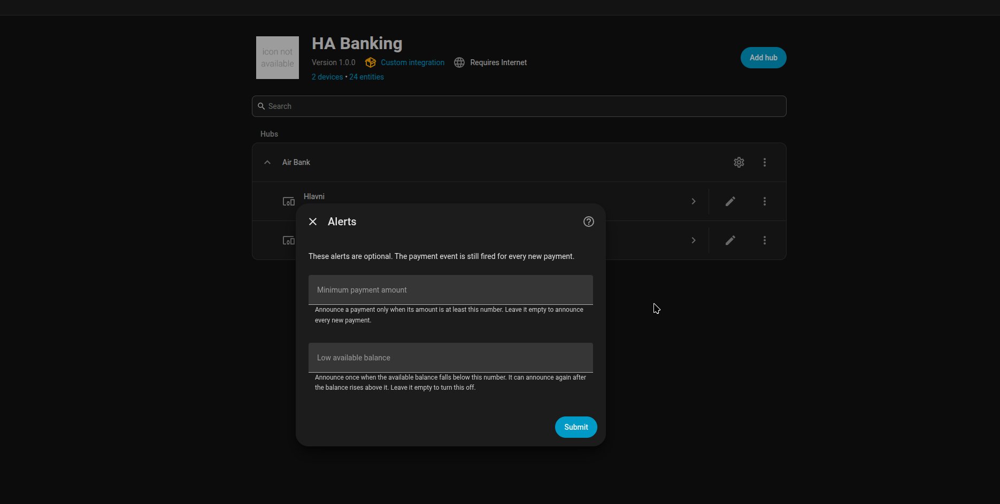

# HA Banking

**Security is your responsibility.** The author does not accept liability for the security of this integration, for how you configure it, or for what happens to your mailbox, certificates, or bank data. Use it only if you are comfortable with that. Read the code and check it yourself, including with your own AI, before you connect a real account.

Read-only Home Assistant integration for bank accounts. With a bank API it tracks booked and available balances, the latest incoming payment, the latest outgoing payment, and the status of the newest transaction. With email notices it tracks only the latest incoming and outgoing payment. Air Bank is the first bank with a direct API and an email parser. Česká spořitelna can also be read through its own API when the user brings an approved application. mBank is read from its daily E-mail Push summary. Enable Banking can connect other banks. Support for another bank can be added when someone asks for it or opens a pull request.

It does not create or authorize payments.

If anybody is interested in supporting my "sleepless" nights (working mostly between 23:00-3:00) on different projects press:

[](https://www.buymeacoffee.com/hadatko)

Thank you ;)

Setup offers three sign-in methods:

- **Email notices.** Home Assistant reads Air Bank, Česká spořitelna, and mBank notices from your own mailbox. This does not require an account-information licence. Air Bank and Česká spořitelna notices include the available balance. The booked balance is not in those mails.
- **Enable Banking.** Each Home Assistant user registers their own Enable Banking application and connects only their own accounts. Enable Banking does not provide this service to a private person residing in the Czech Republic. Untested against the live service.
- **Bank API.** The next step asks which bank. Air Bank uses a licensed certificate. Česká spořitelna uses the free Premium Accounts API for a personal account: the user creates an application on the Erste developer portal and signs in at George. Fio uses a free watch-only token from its internet banking. Production access for Česká spořitelna has to be approved by the bank. The Česká spořitelna sandbox uses the bank's test accounts. Untested against a live account.

Enable Banking, the Air Bank certificate, the Česká spořitelna API, and the Fio API have automated tests with stand-in HTTP replies. None of them has been confirmed with a real account.

Enable Banking is untested because the service does not accept a private person who lives in the Czech Republic. The country list, the bank choice, and the sign-in redirect were never completed on the live site.

The Air Bank certificate is untested because the Open API requires an account-information licence and a PSD2 client certificate bought from a trust service provider. That certificate was not purchased, so the live sign-in and the mutual TLS connection to Air Bank were never made.

The Česká spořitelna API is untested against a live account because production access has to be approved by the bank for each application. The client is covered by tests that replay the documented account, balance, and transaction replies.

### Česká spořitelna API

1. On the Erste developer portal, create an application for Česká spořitelna and add Accounts API. Set the scope `siblings.accounts` to required. Enable the authorization code grant.
2. Register the Home Assistant redirect URI shown in the form.
3. In Home Assistant, choose Bank API, then Česká spořitelna. Enter the client ID, client secret, and web API key. Leave Sandbox on until the bank approves production.
4. Sign in at George when Home Assistant opens the bank page.

The integration reads payment accounts, booked and available balances, and transactions. It does not read mortgages, and it does not send payments. Email notices for Česká spořitelna stay available as a separate sign-in method.

### Fio API

1. In Fio internet banking, open Nastavení, then API.
2. Create a token with Sledování účtu only. Do not enable payment entry. One token belongs to one account. It starts working five minutes after authorization and lasts 180 days unless automatic extension is turned on.
3. In Home Assistant, choose Bank API, then Fio banka, and paste the token.

Home Assistant reads movements and the closing balance. Fio publishes no separate available balance. Without an extra unlock in internet banking, movements older than 90 days are not returned, so a yearly sum later in the year covers only that window. The integration does not submit payments. Another Fio account needs its own token and a second setup.

MONETA and CREDITAS also offer a free token, but MONETA publishes the request address only after a developer-portal registration and CREDITAS limits keys to partner or licensed applications. Komerční banka does not offer this API to a natural person who is not in business. ČSOB and Raiffeisenbank require a certificate. No public personal read API of this kind was found for mBank, UniCredit, Trinity Bank, Partners Banka, or Max banka. Air Bank stays on the licensed certificate.

## Requirements

- Home Assistant 2025.5 or newer
- The Home Assistant redirect URI registered on the chosen application, when using Enable Banking or a bank API. It is the internet address from Settings → System → Network, with `/auth/external/callback` added at the end.
- For email notices, IMAP access to the mailbox that receives those notices.

### Email notices

1. In Air Bank internet banking on a computer, open Účty a karty, choose the account, then Možnosti, then Info o dění na účtu.
2. Send balance changes by email. Set the threshold to the smallest amount the form allows, and include both increases and decreases if you want outgoing payments as well. Air Bank may delay a notice for a change under 500 CZK, especially a card payment.
3. In Home Assistant, choose Email notices and enter the IMAP server, username, password, and a folder for each bank. For Gmail the server is `imap.gmail.com` and the password is an app password. The Air Bank folder defaults to `airbank`. Another bank asks for its own folder. Account names are optional. Put each account on its own line. The number and the name are separated by an equals sign:

    ```text
    1234567890=Main account
    9999999999=Savings account
    ```
 A mapped number is shown under that name. An unmapped number stays `Air Bank` plus the number.
4. **Mark notices as read** is on. Home Assistant marks a message read only after the payment was imported. A message it could not parse stays unread. Turn the option off to leave every message unread. Gmail does not delete a message because it was marked read.

A Gmail filter can apply a label when the message arrives. For Air Bank, use From `info@airbank.cz` and subject `zůstatku`, then choose Skip Inbox and apply the label `airbank`. For Česká spořitelna, use From `ceskasporitelna@csas.cz` and the label `sporitelna`. In Gmail settings, show that label in IMAP. The folder in Home Assistant must be the same name. Another bank can use a different label and a different folder.

Home Assistant reads the mailbox as soon as the integration is added, and again every 15 minutes. Reloading the integration starts another read immediately. There is no separate button that checks the mailbox sooner.

The first read covers the registered bank senders in that folder for the last 13 months, and always back to 1 January. Each later read asks the folder only for mail with a newer IMAP UID, so a quarter-hour read downloads only what arrived since. The parsed notices and the IMAP position of each folder are also kept in `/config/.storage/ha_banking.<entry id>.mailbox`, readable only by Home Assistant. After a restart the sensors start from that file at once and the mailbox is checked for newer mail in the background. The file is only a cache: when it is missing, belongs to another mailbox, was written by other parser code, or the folder's UIDVALIDITY changed, the whole window is read again. Raw mail is never stored. Removing the integration deletes the file. A notice that is labelled late gets a new UID and still joins the month or year of its date; a notice is not added twice. A notice that arrives just after a read waits for the next one, at most 15 minutes.

The recent payments sensor has a `months` attribute: incoming, outgoing, net and count for each of the last 13 months, and the balance at the end of the month where the bank reports one.

Air Bank is the first parser. Another bank is another parser beside it, with its own sender and its own account identity. A password-protected account statement is ignored. The newest Air Bank notice sets the available balance from the sentence `Dostupný zůstatek k … je …`. The booked balance is not in the mail, so that sensor stays empty. The account name in front of the account number becomes the device name, unless the account-name list gives that number its own name. Notices are summed for the current year and the current month, each as incoming, outgoing, and net. A notice without a date is left out of those sums.

Česká spořitelna reads payment notices from `ceskasporitelna@csas.cz` in the folder `sporitelna`. A received payment says `na účet … právě dorazila platba ve výši …` and `Na účtu je nově k dispozici …`. A sent payment says `z účtu … odešla platba ve výši …` and `Na účtu zůstává k dispozici …`. The booked balance is not in that mail. The other account number is kept as the counterparty. A mailbox that has no `sporitelna` folder still reads Air Bank.

#### mBank

mBank does not send a mail for each payment. It sends one **E-mail Push** summary each morning, about 06:30, for the previous day. The sender is `kontakt@mbank.cz` and the subject is `mBank – Email Push`. The text of the mail is only a cover note. The table of operations is in the attached HTML file, and Home Assistant reads that attachment.

1. In mBank internet banking, turn on E-mail Push for the account.
2. In Gmail, filter From `kontakt@mbank.cz` with subject `Email Push` and apply a label, for example `mbank`. Show that label in IMAP. Enter the same name as the mBank folder in Home Assistant.

Each row of the summary becomes one payment, dated by the day of the summary and the time in the row. Card payments, incoming and outgoing transfers, instant payments, and direct debits are read. A login confirmation or a standing order that was not carried out is not a payment and is skipped. The available balance comes from the newest row (`Dostup.zust` or `dispo`), which includes any overdraft. The booked balance stays empty. Payments arrive in Home Assistant the morning after they happen, so the announcement of a new payment is up to one day late.

A bank whose folder does not exist in the mailbox is skipped, so an Air Bank user does not need an mBank folder and the other way round. Setup accepts the mailbox when at least one bank folder exists.

### Enable Banking

Untested on the live service. Enable Banking does not provide this service to a private person residing in the Czech Republic, so the sign-in was never finished.

1. Create an account at [Enable Banking](https://enablebanking.com/sign-in/).
2. Register an application with the form below and download its private key. Sandbox and production are chosen there and cannot be switched later.
3. For a production application, whitelist your own accounts in the control panel.
4. In Home Assistant, choose Enable Banking and enter the application ID, the private key path, whether the account is personal or business, and the two-letter country of the bank.
5. Choose the bank from the list Enable Banking returns for that country. One application can be added again for another bank.

The private key must be readable by Home Assistant, for example `/config/ha_banking/enablebanking.pem`. Keep that file secret. Do not commit it or share it.



Fill the form as follows:

1. **Environment.** Choose **Production** to read a real Air Bank account. Sandbox uses test data and does not show your balances. The choice cannot be changed after registration.
2. **Private key.** Leave **Generate in the browser and export private key** selected. After Register, the browser downloads a PEM file. That file is the private key Home Assistant will use. The other option is only for a key you created yourself.
3. **Application name.** Any name you will recognize, for example `Air Bank Home Assistant`. Enable Banking shows this name when you approve access to the account.
4. **Allowed redirect URLs.** One URL per line. Use the internet address of your Home Assistant and add `/auth/external/callback`. Copy that address from Settings → System → Network. For an address `https://home.example.com` the line is:

    ```text
    https://home.example.com/auth/external/callback
    ```
5. **Description.** What the application does, for example `Read-only tracking of Air Bank balances and transactions in Home Assistant.`
6. **Email for data protection matters.** Your own email address.
7. **Privacy URL.** A public page that says what happens to the account data. For this integration you can use [the privacy section of this README](https://github.com/Hadatko/ha-banking#privacy).
8. **Terms URL.** A public page with the terms of the application. For this integration you can use [the terms section of this README](https://github.com/Hadatko/ha-banking#terms).

Press **Register** and store the downloaded private key on the Home Assistant host. The application ID is the UUID shown for the new application, and it is also the downloaded file name.

### Air Bank certificate

Untested on the live API. Using it requires an account-information licence and a PSD2 client certificate bought from a trust service provider. That certificate was not purchased, so Home Assistant never signed in to Air Bank.

- An Air Bank Open API application with the AISP scope
- A PSD2 client certificate and private key stored on the Home Assistant host, for example `/config/ha_banking/client.pem` and `/config/ha_banking/client.key`

## Install

Add this repository to HACS as a custom integration repository, install HA Banking, and restart Home Assistant. Then add the integration from Settings → Devices & services. The entry lists one hub for each sign-in and one device for each account.



## Entities

Each account becomes one device with these sensors. Every sensor shows that bank's logo from the public Enable Banking image, resized for an icon. Air Bank uses `https://enablebanking.com/brands/CZ/Air%20Bank/-/resize/128x/`. Another bank uses the same address with its country and name.

- Booked balance, the overall state of the account
- Available balance
- Last incoming payment, with counterparty, dates, message, reference, and status
- Last outgoing payment, with the same details
- Latest transaction status
- Incoming, outgoing, and net for the current year
- Incoming, outgoing, and net for the current month
- Recent payments, the newest 30 movements in the read window



## Dashboard

The integration adds a sidebar dashboard named HA Banking. Adding the first bank asks for its look, **Modern** or **Classic**; later banks use the same one, and the integration options change it for every bank.

**Classic** is the original single page: a section per account with the latest payments, a payment list and statistics-graph charts, on a background picture that follows the light or dark mode. Its charts read recorder statistics that the integration stores on each update.

**Modern** is described below. The first tab, Overview, adds up every account: the total available balance (accounts in another currency are listed beside it), this month and this year, the payments of all accounts by date, and the monthly charts. The sums and charts use the currency most accounts have. Then there is one tab per account: balance with a 30-day sparkline, this month and this year (net, incoming, outgoing), recent payments, the balance at each month end and incoming and outgoing by month for the last 13 months. Tap a row to open its sensor. The monthly charts come from the `months` attribute of the recent payments sensor, so they show the history at once instead of building it up in the recorder.

The dashboard uses three custom cards: [button-card](https://github.com/custom-cards/button-card), [stack-in-card](https://github.com/custom-cards/stack-in-card) and [mini-graph-card](https://github.com/kalkih/mini-graph-card). When one is missing, the integration installs it from the Home Assistant Marketplace or HACS, otherwise from the card's GitHub release into `/config/www/ha_banking/cards/`. Turn off **Install dashboard cards** in the integration options to do this yourself; a repair issue then lists the missing cards and can install them.



Each account starts with the latest payment in each direction and the recent payments. Below that is a line of the available balance for the last year, then bar charts for the same balance, the last 12 months including the current month (incoming, outgoing, net), and this year. The bars use the sensor state, because a monetary sensor does not record an average. A new notice adds another point.


Each account starts with the latest payment in each direction and the recent payments. Below that is a line of the available balance for the last year, then bar charts for the same balance, the last 12 months including the current month (incoming, outgoing, net), and this year. The bars use the sensor state, because a monetary sensor does not record an average. A new notice adds another point.

## Notifications

The first read after Home Assistant starts remembers the payments already in the mailbox or the bank history. It does not announce them. A later read, at most 15 minutes afterwards, announces only a payment that was not in that first set.

The announcement is a Home Assistant notification, the item under the bell. It stays until you dismiss it. The same payment also fires the `ha_banking_payment` event, so an automation can send it somewhere else. The integration itself does not push to a phone.

The title follows the Home Assistant language. English uses "New bank payment", Slovak "Nová platba", and Czech "Nová platba". The message is the account name, the direction, the amount, and the currency. When the notice names the other side, that name is added to the message and to the payment list. With English selected, the direction reads Incoming or Outgoing.

Open the integration and choose Configure to set two optional limits. Minimum payment amount announces a payment only when it is at least that amount. Leave it empty to announce every new payment. The `ha_banking_payment` event is still fired for every new payment. Low available balance announces once when the balance falls below the amount, and again only after the balance has risen above it. A restart does not repeat an alert that is already true.



A restart clears that memory and the next first read is quiet again. During one run, the same payment is announced once.

Data is refreshed every 15 minutes. The mailbox is included in that schedule: the first read runs when the email entry is added, and the following reads run every 15 minutes. With the direct Air Bank certificate, a refresh token stays valid for 180 days after the last strong login, and transaction history older than 90 days is only available immediately after that login. The year and month sums use transactions from 1 January, or the last 90 days when that reaches into the previous year. With Enable Banking, the bank consent lasts until the date agreed at sign-in. When it ends, Home Assistant asks for sign-in again. The same date window applies. With email notices, the available balance comes from the newest notice and the booked balance stays empty. The year and month sensors add every parsed notice in that period. Marking a notice read is on unless that option is turned off.

## Privacy

This integration runs inside your Home Assistant. The Enable Banking application ID, private key, Air Bank certificate, and mailbox password stay on that host. Account data is stored as Home Assistant sensor states. This project does not run a server that receives your bank data, and it does not send payments.

Enable Banking and the mailbox provider apply their own privacy terms to those connections. Email notices are read from your IMAP server. Only messages from `info@airbank.cz`, `ceskasporitelna@csas.cz`, and `kontakt@mbank.cz` are parsed.

## Terms

The integration is provided under the MIT license in this repository. It reads balances and transactions, or the latest payment from your own Air Bank emails. It does not create, authorize, or cancel payments. You use your own mailbox, your own Enable Banking application, or your own Air Bank certificate.
